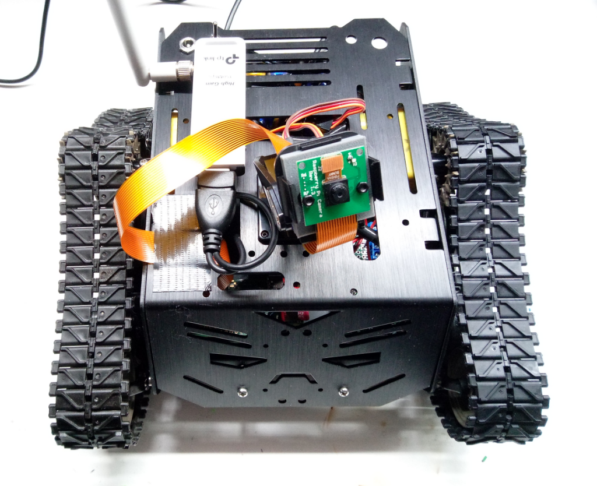
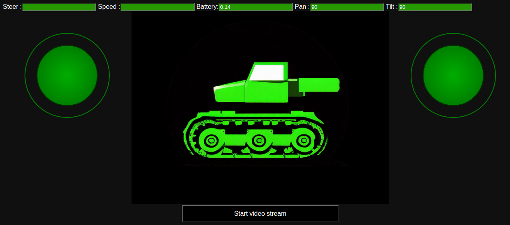

# Tankie
Remote Controlled Tank for AI integration
<br>
<br>
<br>


## Description
Tankie is a DFRobot Devastator Tank platform controlled by an ESP8266 micro
controller and a SparkFun Dual TB6612FNG Motor Driver. It can connect to an
existing WiFi network or provide an access point to connect to. Remote control
works via websocket. Additionally a pan/tilt bracket kit with two servos is
installed on top, which can be used to attach a camera and move it around.

This repository contains the motor and pan/tilt control (ESP8266) as well as
the video input. For video, an additional Raspberry Pi Zero 2 W with a camera
is installed on top of the tank; its setup (mediamtx streaming) lives in the
[raspberry_pi/](raspberry_pi/) directory. Audio input is still being worked out.

## Documentation
The full reference lives in [`docs/`](docs/README.md) — a cross-linked set of
topic pages (every page links to the home and the [docs index](docs/README.md),
and each carries a "See also" footer, so any page reaches any other in one hop).
AI agents: start at [`docs/AGENTS.md`](docs/AGENTS.md) /
[`docs/manifest.json`](docs/manifest.json).

| Topic | Page |
|---|---|
| Hardware (parts + wiring) | [docs/hardware.md](docs/hardware.md) |
| Build (toolchains + **all** dependencies) | [docs/build.md](docs/build.md) |
| WiFi configuration | [docs/wifi-config.md](docs/wifi-config.md) |
| Firmware & data upload | [docs/ota.md](docs/ota.md) |
| Serial control protocol (Pi ↔ ESP) | [docs/serial-protocol.md](docs/serial-protocol.md) |
| Testing + CI | [docs/testing.md](docs/testing.md) |
| AI control (safety + config) | [docs/ai-control.md](docs/ai-control.md) |

## Quick start
1. **Assemble** the tank — parts + wiring in [docs/hardware.md](docs/hardware.md).
2. **Build & flash** the firmware once, over USB:
   ```
   pip install platformio
   pio run -t upload      # firmware
   pio run -t uploadfs    # LittleFS data (web UI)
   ```
   (PlatformIO is the recommended local toolchain; arduino-cli and the Arduino
   IDE also work — see [docs/build.md](docs/build.md).)
3. **Join the WiFi** — connect to the `tankie-esp` access point and open
   `http://192.168.4.1:8080` to enter your network details
   ([docs/wifi-config.md](docs/wifi-config.md)).
4. **Drive it** — open `http://<ip_of_tankie>` and use the joysticks (below).
5. **Update later** over the air via the ElegantOTA portal
   ([docs/ota.md](docs/ota.md)).

## Parts
The bill of materials and the hardware wiring are in
[docs/hardware.md](docs/hardware.md). In short: a DFRobot Devastator chassis, a
D1 Mini (ESP8266), a SparkFun Dual TB6612FNG motor driver, a 5 V DC-DC
converter, a pan/tilt bracket kit, two G90 micro servos, and a breadboard.

## Usage

### RC (web UI)
Connect to `http://<ip_of_tankie>` in a browser. You should see a control
interface with two joysticks and fields that display steer, speed, pan and tilt
values as well as the current voltage of the power supply.
<br>
<br>
<br>


### AI
The [ai-control/](ai-control/) folder contains the code that connects an AI to
the tank (see [ai-control/README.md](ai-control/README.md)). Usage, safety,
state feedback and configuration are documented in
[docs/ai-control.md](docs/ai-control.md).

### Firmware & data updates
Update the firmware and the LittleFS web UI over the air via the ElegantOTA
portal at `http://<ip_of_tankie>/update` — see
[docs/ota.md](docs/ota.md).

## Projects used
- [joy.js](https://github.com/bobboteck/JoyStick)
- [SparkFun TB6612 library](https://github.com/sparkfun/SparkFun_TB6612FNG_Arduino_Library)
