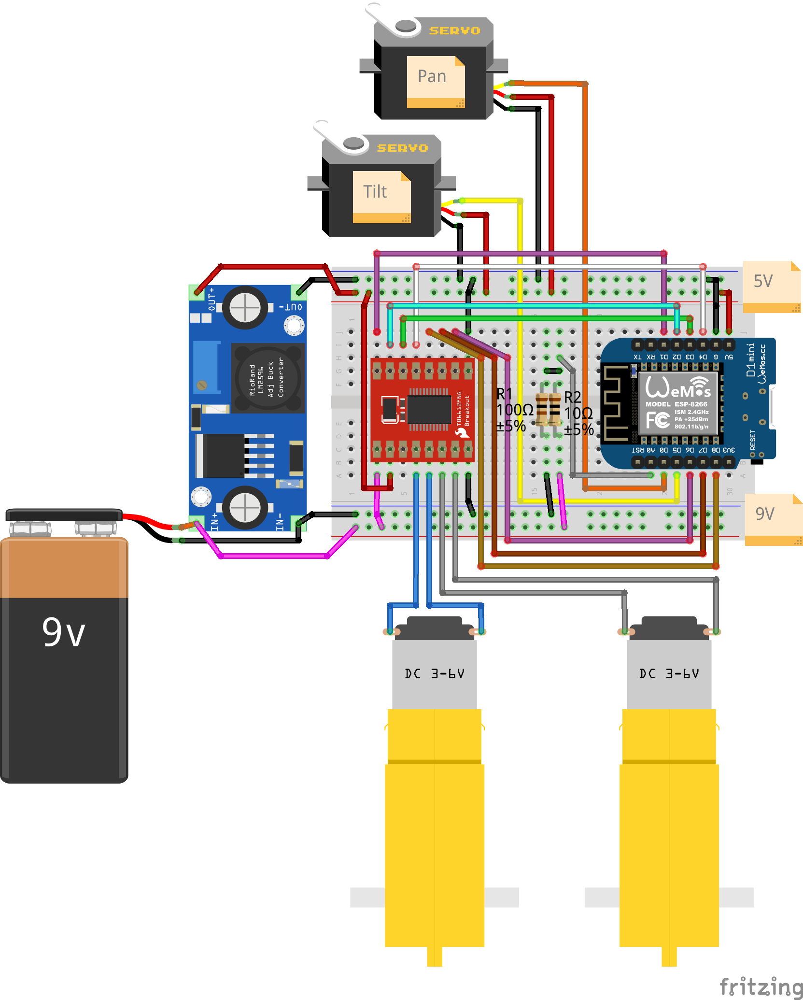

← [Tankie](../README.md) · [Docs index](README.md) · *Hardware*

# Hardware

## Parts

| Qty | Part |
|---|---|
| 1x | [DFRobot Devastator](https://www.berrybase.de/dfrobot-devastator-tank-mobile-roboterplattform) |
| 1x | [D1 Mini – ESP8266 Micro Controller](https://www.berrybase.de/en/detail/019234a3e5a1705e9e602f2dd7ea7f72) |
| 1x | [SparkFun Motor Driver – Dual TB6612FNG](https://www.sparkfun.com/sparkfun-motor-driver-dual-tb6612fng-1a.html) |
| 1x | [USB DC Buck Step Down Converter 6-24V 12V/24V To 5V 3A](https://www.diymore.cc/products/usb-dc-buck-step-down-converter-6-24v-12v-24v-to-5v-3a-car-charger-module) |
| 1x | [Pan/Tilt Bracket Kit](https://www.robotshop.com/products/pan-tilt-bracket-kit-single-attachment) |
| 2x | [G90 Micro Servo 5V Plastic Motor](https://eckstein-shop.de/WaveShare-SG90-Micro-Servo-5V-Plastic-Motor-180Grad-EN) |
| 1x | [Breadboard](https://www.berrybase.de/en/detail/019234a3c572735085405d3bf4e22c71) or [breadboard, double-sided, 70 x 50 mm](https://www.reichelt.com/de/en/shop/product/breadboard_double-sided_70_x_50_mm-319111?&LANGUAGE=en) |

## Hardware setup

**Please note:** The DC-DC converter and 9V power source in the image are
wrong — a 9V battery won't be sufficient to power Tankie. Use the 6x 1.5V
battery box that comes with the Devastator Kit. The DC-DC converter in the
image can be used, however it requires the output voltage to be adjusted
manually; we'd suggest using the converter in the parts list instead.

## Firmware configuration

Pinout and other hardware-related settings (servo/motor pins, AP name +
password, etc.) are set in [`tankie/config.h`](../tankie/config.h).

---

## See also
- [Build](build.md) — how to compile and flash the firmware for this hardware
- [WiFi configuration](wifi-config.md) — first-boot network setup
- [Tankie (home)](../README.md)
